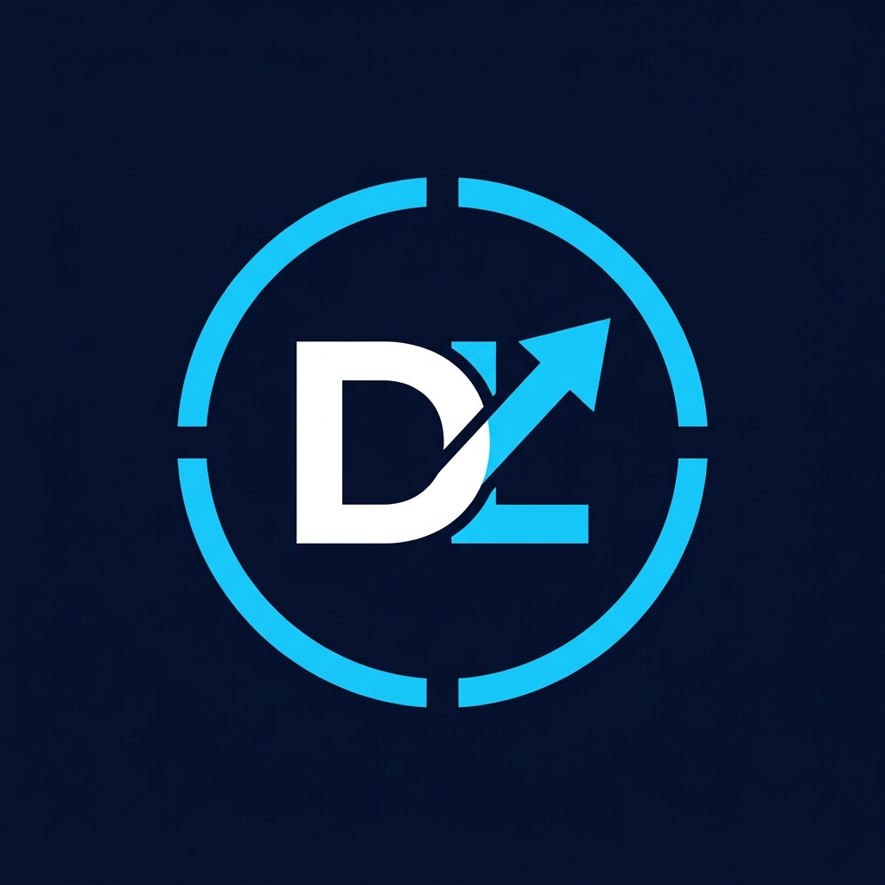

<div align="center">
  
  <h1>ConcursoStudio — DL Concurseiro</h1>
  <p><strong>Gerador de imagens 1080px para redes sociais focado no nicho de Concursos Públicos.</strong></p>

  <p>
    <a href="https://daniellucas2025.github.io/dlconcurseiro/">
      
    </a>
    
    
    
  </p>
</div>

---

## O que é o ConcursoStudio?

O **ConcursoStudio** é uma ferramenta web (100% estática, sem necessidade de servidor ou instalação complexa) criada para **concurseiros, professores, mentores e studygrams** produzirem posts profissionais em segundos e exportarem em **PNG de alta resolução (1080px)** pronto para o Instagram, TikTok, YouTube e WhatsApp.

> **Abrir agora:** [https://daniellucas2025.github.io/dlconcurseiro/](https://daniellucas2025.github.io/dlconcurseiro/)

---

## Principais Recursos

* **35 Modelos de Post** filtráveis por objetivo (*Engajamento, Conteúdo, Notícias e Vendas*).
* **4 Formatos Oficiais do Instagram:**
  * Feed Retrato (`1080×1350` • `4:5`)
  * Feed Novo IG (`1080×1440` • `3:4`)
  * Feed Quadrado (`1080×1080` • `1:1`)
  * Stories / Reels (`1080×1920` • `9:16`) com **Guias de Zona Segura** opcionais.
* **Importador Inteligente de Questões:** cole questões do **TEC Concursos**, **QConcursos** ou **Gran** (incluindo letras `A–E`, *Certo/Errado*, Banca, Ano e Cargo/Matéria) e preencha tudo em 1 clique.
* **Imagem no Enunciado (`Ctrl+V` / Upload):** anexe prints, gráficos ou tabelas direto no enunciado da questão.
* **Carrossel & Prévia Multi-página:** navegue entre *Pergunta* e *Gabarito* direto na prévia (com suporte a *swipe* no celular) e baixe os 2 PNGs automaticamente ao clicar em download.
* **Banco com 1.000 Frases Motivacionais:** 10 temáticas × 100 frases com busca, sorteio e **exportação em lote `.ZIP`** (5 imagens + `legendas.txt`).
* **Identidade White-Label + Exportação de Logo:** personalize `@arroba`, nome/slogan, paleta, cor de destaque, foto de fundo, estilo de escrita à mão, **cor independente da logo** (com download `1080×1080` para perfil do Instagram) e **Modo Free/Pro**.
* **Legenda Pronta & Rascunhos Locais:** gere a legenda completa com hashtags em 1 clique e salve rascunhos no navegador (`localStorage`).
* **PWA Mobile:** funciona no celular com barra de ações rápida e suporte offline via Service Worker.

---

## Modelos Disponíveis (35)

| Categoria | Modelos |
| :--- | :--- |
| **Engajamento** | Questão Comentada (2 Slides), Metas / KPIs, Erros Comuns, Motivação (1.000 frases), Enquete / Debate, Complete a Lacuna, Verdadeiro ou Falso (Combo), Meme 2 Quadros, Mito vs. Verdade |
| **Conteúdo** | Rotina / Lei Seca, Não Confunda (VS), Checklist / Top, Flashcard, Mnemônico, Súmula / STF, Cronograma, Raio-X da Banca, Dica Relâmpago, Vade Mecum Grifado (`==marca-texto==`), Tabela de Prazos, Glossário Jurídico, Redação Nota Máxima |
| **Notícias** | Saiu Edital (com Data da Prova), Contagem Regressiva, Quanto Ganha?, Plantão / News, Nota de Corte, Termômetro do Edital, Calendário de Provas, Kit do Dia de Prova |
| **Vendas & Autoridade** | Capa Reels / YouTube, Aprovado (Prova Social), Antes & Depois, Aviso de Live, Indicação / Link |

---

## Como Rodar Localmente

```bash
git clone https://github.com/daniellucas2025/dlconcurseiro.git
cd dlconcurseiro
python -m http.server 8765
```

Depois acesse `http://localhost:8765` no navegador.
